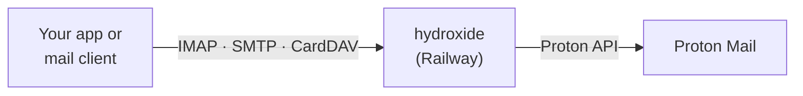

<div align="center">

# Proton Mail Bridge on Railway

**Use your Proton Mail account over standard IMAP, SMTP and CardDAV, hosted on Railway.**

[](https://railway.com/deploy/proton-mail-bridge?referralCode=HxrUPo&utm_medium=integration&utm_source=template&utm_campaign=generic)

Powered by [hydroxide](https://codeberg.org/emersion/hydroxide), an open-source, headless Proton Mail bridge.

</div>

---



- 📥 **Read mail** from scripts, automations or AI agents over IMAP
- 📤 **Send mail** from your apps through your Proton address over SMTP
- 👥 **Sync contacts** with any CardDAV client
- 💾 **Keeps your session** on a persistent volume across redeploys

The image builds hydroxide from the latest Codeberg source, which includes support for Proton's CAPTCHA check. Older builds from the GitHub mirror can't log in when Proton asks for a CAPTCHA.

## Contents

- [Quick start](#quick-start)
- [Connection settings](#connection-settings)
- [Configuration](#configuration)
- [Troubleshooting](#troubleshooting)

## Quick start

### 1. Log in on your own machine

Proton requires an interactive login and usually a CAPTCHA, so this step can't run on Railway. You need [Go 1.26+](https://go.dev/dl/).

```bash
git clone https://codeberg.org/emersion/hydroxide.git
cd hydroxide && go build ./cmd/hydroxide
./hydroxide auth <your-proton-address>
```

1. Enter your Proton password.
2. If a `verify.proton.me` link appears, open it, solve the CAPTCHA, then press **Enter**.
3. If 2FA is on, enter the code from your authenticator app. Security keys aren't supported.
4. Copy the **bridge password** it prints.

> [!IMPORTANT]
> The bridge password is what your mail clients log in with. hydroxide doesn't store it and can't show it again. If you lose it, run `hydroxide auth` again.

### 2. Encode the session

```bash
# Linux
base64 -w0 ~/.config/hydroxide/auth.json

# macOS
base64 -i ~/Library/Application\ Support/hydroxide/auth.json
```

The file is encrypted with the bridge password, so it's useless without it.

### 3. Deploy

Click **Deploy on Railway** above and paste the output into `HYDROXIDE_AUTH_JSON_B64`. The template creates the service and the `/data` volume.

When the deploy logs show these lines, the bridge is ready:

```text
Seeded /data/hydroxide/auth.json from HYDROXIDE_AUTH_JSON_B64
SMTP server listening on :1025
IMAP server listening on :1143
CardDAV server listening on :8080
```

<details>
<summary>Setting it up by hand instead</summary>

1. Create a service from this repo.
2. Attach a volume mounted at `/data`.
3. Set `HYDROXIDE_AUTH_JSON_B64`, plus any of the optional [variables](#configuration).
4. Keep the service at **one replica**.

</details>

## Connection settings

Log in with your **Proton address** and the **bridge password**, not your Proton password.

| | IMAP | SMTP | CardDAV |
| --- | --- | --- | --- |
| **Host** | `<service>.railway.internal` | `<service>.railway.internal` | `http://<service>.railway.internal:8080` |
| **Port** | `1143` | `1025` | `8080` |
| **Security** | None | None | None (HTTPS through a Railway domain) |
| **Authentication** | Normal password | Normal password | Basic |

This template doesn't configure TLS, so IMAP and SMTP offer neither SSL/TLS nor STARTTLS. Pick **None** in your client, or the connection will fail.

### Where it's safe to connect from

| Client location | How | Safe? |
| --- | --- | --- |
| Another service in the same Railway project | Private network (`*.railway.internal`) | ✅ Yes. Traffic stays inside Railway. |
| CardDAV from anywhere | Railway public domain with target port `8080` | ✅ Yes. Railway provides HTTPS. |
| IMAP or SMTP from your computer | Railway TCP proxy | ⚠️ No, not without TLS. |

> [!WARNING]
> **Don't expose IMAP or SMTP through a TCP proxy as it is.** Without TLS, hydroxide accepts plaintext logins. Your address, the bridge password and your email would cross the internet unencrypted, and the bridge password gives full access to your mailbox.

<details>
<summary>About TLS</summary>

hydroxide supports `-tls-cert` and `-tls-key`. With a certificate, IMAP and SMTP switch to implicit TLS, so clients would use **SSL/TLS** (not STARTTLS). This template doesn't pass a certificate yet.

A trusted certificate such as Let's Encrypt needs a domain you control. You can't get one for Railway's TCP proxy hostname, so for outside access you'd use a self-signed certificate and accept it once in your mail client.

</details>

## Configuration

| Variable | Default | Description |
| --- | --- | --- |
| `HYDROXIDE_AUTH_JSON_B64` | **required** | Base64 of `auth.json` from [step 2](#2-encode-the-session). Used only when `/data` has no session yet. |
| `HYDROXIDE_AUTH_FORCE` | unset | Set to `1` for one deploy to replace the stored session, for example after logging in again. Remove it afterwards. |
| `SMTP_PORT` | `1025` | SMTP port. |
| `IMAP_PORT` | `1143` | IMAP port. |
| `CARDDAV_PORT` | `8080` | CardDAV port. |

Railway's automatic `PORT` variable is ignored, because it can clash with the mail ports.

**Several accounts:** `auth.json` holds one entry per account. Run `hydroxide auth` for each account on the same machine, then encode the file once. Each account has its own bridge password.

**Token refresh:** hydroxide refreshes Proton tokens itself and saves them to `/data`. That's why the env var is only read on first boot.

## Troubleshooting

<details>
<summary><code>[9001] For security reasons, please complete CAPTCHA</code> when running <code>hydroxide auth</code></summary>

Your hydroxide build is too old to handle Proton's CAPTCHA. `go install github.com/emersion/hydroxide/...` installs an outdated version from the GitHub mirror. Build from Codeberg as shown in [step 1](#1-log-in-on-your-own-machine).

</details>

<details>
<summary><code>listen tcp :1025: bind: address already in use</code></summary>

Two listeners are set to the same port. Check that `SMTP_PORT`, `IMAP_PORT` and `CARDDAV_PORT` are all different, and redeploy from the latest commit of this repo.

</details>

<details>
<summary><code>No auth.json: set HYDROXIDE_AUTH_JSON_B64</code></summary>

The variable is empty and the volume has no session. Set `HYDROXIDE_AUTH_JSON_B64` and check that the volume is mounted at `/data`.

</details>

<details>
<summary>The mail client can't connect or log in</summary>

- Security must be **None** (see [connection settings](#connection-settings)).
- Use the bridge password, not your Proton password.
- If you ran `hydroxide auth` again, you got a new bridge password that only matches the new `auth.json`. Update the variable and deploy once with `HYDROXIDE_AUTH_FORCE=1`.

</details>

## Credits

[hydroxide](https://codeberg.org/emersion/hydroxide) is written by emersion and released under the MIT License. This project and hydroxide are not affiliated with or endorsed by Proton AG.
